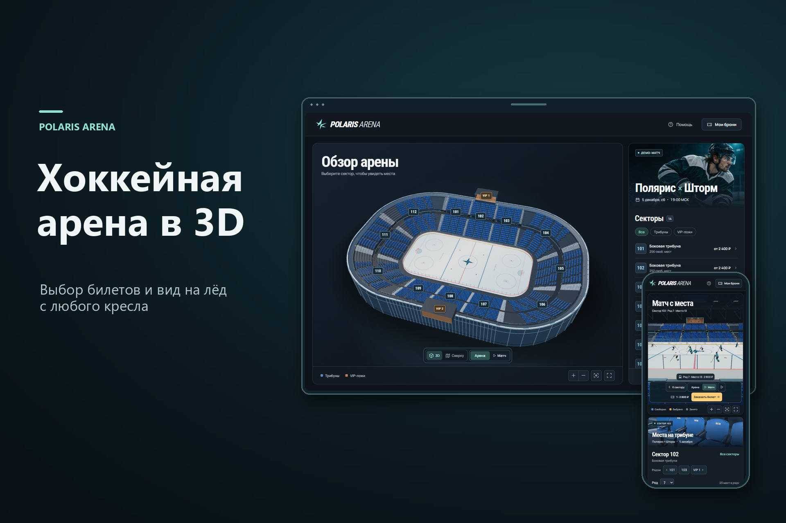

# Polaris Arena

Интерактивная 3D-арена для выбора билетов на хоккей. Зритель выбирает кресла непосредственно на трибуне, смотрит матч с каждого места и бронирует подходящие билеты. В модели 4 788 мест, 12 секторов и две VIP-ложи.

**[Открыть арену](https://kenaiservice.ru/reservation/)** · [Посмотреть видеодемонстрацию](portfolio/03-video.mp4)

## Как попробовать

1. Откройте сектор. При наведении подсвечивается трибуна, а внутри сектора — ряд и кресло. На телефоне используйте касание.
2. Выберите до восьми свободных мест. У каждого видны ряд, номер и цена. Повторный клик убирает кресло из заказа.
3. Нажмите **Посмотреть с места**. Камера подлетит к креслу и покажет игру с высоты глаз зрителя. Кнопка **К сектору** вернёт прежний обзор, а **Следующее место** позволит сравнить ракурсы.
4. Нажмите **Заказать билеты**. Демо-бронь действует десять минут. Её можно отменить в разделе **Мои брони** в том же браузере.

Секторы, команды, цены и расписание демонстрационные. Проект показывает рабочее бронирование без оплаты и выдачи билетов.

## Локальный запуск

Понадобится Node.js 24 или новее. Из корня проекта выполните

~~~sh
npm ci
npm run build
npm start
~~~

Откройте [127.0.0.1:4173](http://127.0.0.1:4173/). Для разработки используйте `npm run dev`, для проверки — `npm test`. Blender для запуска сайта не требуется.

## Как устроен проект

| Компонент | Назначение |
| --- | --- |
| [Модель арены](model/Polaris.blend) | Редактируемая сцена Blender, трибуны, обычные и клубные кресла. |
| [Модели для браузера](public/arena/) | Геометрия GLB, расположение и номера мест, рендеры кресел. |
| [Клиент](src/) | Three.js и Vite. Выбор кресла в 3D, подсветка, маршруты камеры, анимированный матч и мобильный интерфейс. |
| [Сервер](server/) | Node.js и SQLite. API выдаёт цены и доступность, проверяет каждое выбранное кресло и оформляет всю группу одной транзакцией. |
| [Проверки](test/) | Конкурирующие брони, отмена и истечение, выбор секторов, геометрия и траектории камеры. |

Статус места и итоговую стоимость определяет сервер. SQLite хранит данные в `data/reservations.sqlite`. Путь можно изменить через `ARENA_DATA_DIR`. Собственные брони определяются по cookie браузера.

Для пересборки модели с фотографиями кресел запустите Blender из корня проекта. Готовые модели уже включены в репозиторий.

~~~sh
blender -b --python-exit-code 1 -P model/build_arena.py -- --portraits
blender -b --python-exit-code 1 -P model/players.py
~~~

## Docker и публикация

`docker compose up -d --build` поднимает приложение на [127.0.0.1:4196](http://127.0.0.1:4196/). База сохраняется в отдельном томе. Приложение запускается от пользователя `node`; HTTP-порт привязан к loopback.

На kenaiservice.ru nginx обслуживает [маршрут /reservation/](deploy/reservation.conf). Он передаёт запросы приложению без префикса. Для этого размещения задаются `SESSION_PATH=/reservation/` и `SESSION_SECURE=1`. Статика и запросы к API используют относительные адреса. Для обновлений `RELEASE_VERSION` задаёт тег образа; предыдущий образ можно запустить с тем же томом данных.
